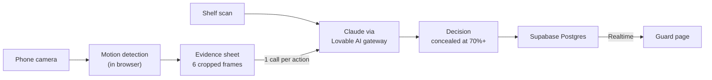

# TheftWatch

Shoplifting detection for any shop, using any phone.

**Live app:** [theft-watch.lovable.app](https://theft-watch.lovable.app)

TheftWatch turns an ordinary phone into a smart CCTV camera. It learns a shelf's stock from one scan, follows each action from shelf to hand to pocket, and alerts a guard's phone with evidence only when a stock item is concealed.

## Features

- **Understands actions, not just objects:** tracks an item across a whole movement.
- **No training needed:** learns any shelf in seconds.
- **Explainable:** every decision, including not alerting, comes with a reason.
- **Low cost:** motion detection runs on the phone; the AI is called once per action.
- **Human in the loop:** guards confirm alerts or mark them as false alarms. No video is stored.

## How it works

| Page | Purpose |
| --- | --- |
| `/camera` | Watches the shelf (run on a phone) |
| `/camera?view=1` | Live mirror with the decision log (for a laptop) |
| `/guard` | Live incident feed for guards |

**Built with** TanStack Start, React, TypeScript, Tailwind CSS, Supabase, Claude and MediaPipe.

See [demo.md](demo.md) for the full technical breakdown.
