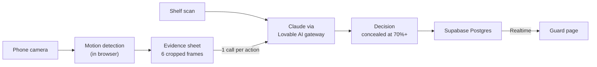

# TheftWatch

Shoplifting detection for any shop, using any phone.

**Live app:** [theft-watch.lovable.app](https://theft-watch.lovable.app)

TheftWatch turns an ordinary phone into a smart CCTV camera. It scans a shelf to learn its stock, follows each action from shelf to hand to pocket, and alerts a guard's phone with evidence frames only when a stock item is concealed. Every decision, including the decision not to alert, comes with a stated reason.

## Features

- **Action understanding, not object boxes.** Follows an item across a whole action, not single frames.
- **Learns a shelf in seconds.** One scan at start-up, with no training data or labelling.
- **Explainable decisions.** Personal belongings, items put back and low-confidence calls are logged with a reason instead of raising an alert.
- **Low cost per camera.** Motion detection and live object boxes run on the phone; the AI is called once per finished action.
- **Human in the loop.** Guards see each alert live, with six evidence frames, and confirm it or mark it as a false alarm. No video is stored.

## How it works



1. The camera page captures frames at 3 fps and watches a low-resolution motion grid.
2. When motion starts and settles, the action is cropped to the moving area and packed into a 3x2 evidence sheet.
3. A server function sends the sheet and the shelf list to Claude, which tracks the item and returns a JSON verdict.
4. A validated "concealed" verdict at 70% confidence or higher is saved as an incident; the guard page receives it through Supabase Realtime.

See [demo.md](demo.md) for the full technical breakdown and the demo script.

## Pages

| Route | Purpose |
| --- | --- |
| `/` | Landing page |
| `/camera` | Camera that watches the shelf (run on the phone) |
| `/camera?view=1` | Live mirror of the camera with the decision log (for a laptop) |
| `/guard` | Live incident feed for store guards |

## Tech stack

- [TanStack Start](https://tanstack.com/start) with React 19, TypeScript and Vite
- Tailwind CSS and shadcn/ui
- [Supabase](https://supabase.com) for Postgres and Realtime
- Claude through the [Lovable](https://lovable.dev) AI gateway
- Google MediaPipe for in-browser object detection
- Vitest for tests

## Getting started

Prerequisites: Node.js 20+ (or Bun) and a Supabase project.

```sh
git clone https://github.com/lambyflowerpot/couple-hack.git
cd couple-hack
npm install
```

Create a `.env` file in the project root. It is ignored by git.

```sh
SUPABASE_PROJECT_ID=...
SUPABASE_URL=...
SUPABASE_PUBLISHABLE_KEY=...
VITE_SUPABASE_PROJECT_ID=...
VITE_SUPABASE_URL=...
VITE_SUPABASE_PUBLISHABLE_KEY=...
```

The AI server function also needs `LOVABLE_API_KEY`, which Lovable provides at runtime.

Start the dev server:

```sh
npm run dev
```

## Scripts

| Command | Description |
| --- | --- |
| `npm run dev` | Start the development server |
| `npm run build` | Build for production |
| `npm run preview` | Preview the production build |
| `npm test` | Run the test suite |
| `npm run lint` | Lint the code |
| `npm run format` | Format the code with Prettier |

## Project structure

```
src/
  detector/       Motion detection, framing, shelf matching and alert decisions
  lib/            Server functions, including the AI analysis call
  routes/         File-based routes (landing, camera, guard)
  components/     Shared UI components
  integrations/   Supabase client and generated types
```

## Development with Lovable

This project is connected to [Lovable](https://lovable.dev/projects/976cdb11-8b55-4a04-b9d6-76e93a6b442a). Changes merged into `main` sync back to the Lovable editor, and changes made in Lovable are committed to `main`.
