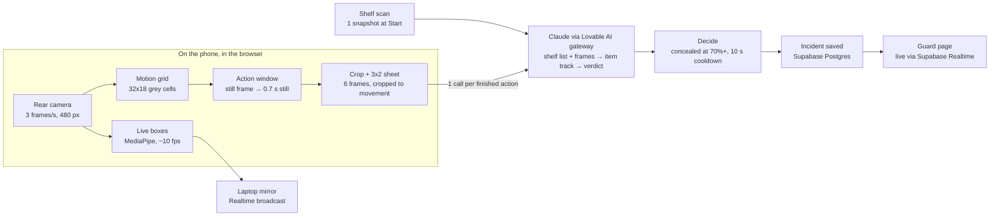

# TheftWatch demo plan

A phone watches a shelf, learns its stock, and alerts a guard's phone with evidence only when a stock item is hidden. It explains every decision it makes along the way.

## Setup (about 15 minutes before the judges arrive)

- [ ] **Camera:** phone in the Insta360 Flow 2 Pro, standing on its built-in tripod legs. Locked mode, AI tracking off. On a stool or the table edge, angled down at the table. It must not move.
- [ ] **Scene:** table against a wall, lights behind the camera (not behind the table). The thief stands side-on, so the hand going to the pocket is visible.
- [ ] **Items:** 3 items spread apart, for example crisps, a chocolate bar and a water bottle.
- [ ] **Laptop:** left window `/camera?view=1` (live mirror), right window `/guard`. Open the mirror first so the decision log captures everything.
- [ ] **Guard phone:** a second phone on `/guard` with sound enabled.
- [ ] **Clean slate:** mark old TEST incidents as false alarms, so Guard starts at 0 new.
- [ ] **Steady check:** start `/camera` with nobody at the table and watch the log for 30 s. Any "Action finished" line means the camera is moving.
- [ ] **Dry run:** all three takes once. Note the "AI replied in …" times from the log for the Q&A.
- [ ] **Backup clips:** record each take as a video on the camera phone (see Backup plan).

**Roles**

- **Narrator:** talks to the judges and points at the laptop.
- **Thief:** taps Start, then performs the three takes.
- **Guard:** holds the guard phone up when the alert arrives.

## Script (about 3 minutes)

| Time | On screen | Narrator says |
| --- | --- | --- |
| 0:00 | Landing page with the UK stats | Shop theft is rising, and staff can't watch every aisle. |
| 0:20 | Tap **Start**: status shows Scanning, then the shelf list appears on the laptop | "An ordinary phone. It just learned what's on this shelf in a few seconds, with no training, including products a standard object detector has never seen." |
| 0:45 | **Take 1:** pocket your *own* phone | Point at the log: *No alert: nothing taken from the table*. "It knows your belongings from the shop's stock." |
| 1:05 | **Take 2:** pick up the crisps, then put them back | The shelf list shows *taken*, then *put back*. "Handling isn't stealing." |
| 1:30 | **Take 3:** take the chocolate and pocket it | The item track line, the red **ALERT**, the guard phone beeps and shows the evidence frames. "The guard gets proof, not just an alarm." |
| 2:00 | Walk through the decision log | The technical walkthrough below, pointing at real log lines. |
| 2:40 | Close | The five differences below. |

## Why it's different

1. **It understands actions, not objects.** Most CV projects draw boxes on single frames. This follows an item from shelf to hand to pocket across a whole action.
2. **It learns a shelf in seconds.** One scan sets up any shelf with any products: no training data, no labelling.
3. **It knows when *not* to alert, and says why.** Your own phone, an item put back, or low confidence each produce a stated reason. Every alert is explainable.
4. **Cheap enough for every camera.** Motion detection and the live boxes run on the phone; the AI is called once per finished action, never while the scene is still.
5. **Any phone, with a human in the loop.** No new hardware, no stored video: an alert keeps only the six evidence frames, and the guard confirms or marks a false alarm.

## How it works

| Part | What it does | Why |
| --- | --- | --- |
| Capture | Rear camera, 3 frames a second at 480 px wide | Catches a quick hand move; cheap on a phone |
| Motion | Each frame shrunk to a 32x18 greyscale grid; a cell counts as changed past 20/255; the scene is active at 6+ changed cells | A moving hand counts; light flicker doesn't |
| Action window | From the still frame before motion until 0.7 s of stillness, in chunks of at most 4 s | The AI sees the whole action, not half of it |
| Crop | Every cell that moved, plus a 2-cell margin, never smaller than half the frame | Hands and item appear about 2x larger, with the shelf and pocket still in view |
| Evidence sheet | 6 frames picked evenly, numbered in a 3x2 grid, 1280x720 JPEG | One image per AI call, frames in time order |
| Shelf scan | One 960 px snapshot after a 1 s exposure settle; up to 8 items | The AI knows store stock from personal belongings |
| AI | Claude Sonnet through Lovable's AI gateway, called from a server function | The API key never reaches the browser |
| Reply | The item's position in each frame first, then a JSON verdict; validated, and anything malformed counts as "none" | Tracking first improves the call; a bad reply can never cause an alert |
| Decision | Alert only on "concealed" at 70%+ confidence; 10 s cooldown; one call at a time with the latest action queued; 10 s pause after an AI error | Few false alarms; no lost actions; no runaway calls |
| Live boxes | Google MediaPipe EfficientDet-Lite0 in the browser, about 10 fps, GPU with CPU fallback | Instant visual feedback with no server |
| Alerts | A row in Postgres (item, location, confidence, reason, evidence image); the Guard page updates through Supabase Realtime | The guard sees it within a second of the decision |
| Laptop mirror | Supabase Realtime broadcast: 640 px frames at 5 fps, sent only while a viewer is open; the viewer validates every message | Judges see the process on a big screen; no wasted data |
| Quality | 34 automated tests: reply parsing, motion, cropping, action windows, item matching, alert decision | We can change tuning without breaking behaviour |

## Judge Q&A

| Question | Answer |
| --- | --- |
| Why not just YOLO? | Object detectors know fixed categories in single frames. Theft is a sequence, and shop products aren't in standard category lists. We use local detection for speed and the AI for judgement. |
| How fast is it? | Quote the AI reply times from the decision log on the day, plus about 0.7 s to confirm the action has ended. Don't guess a number. |
| What does it cost to run? | One AI call per finished action, none while the scene is still. |
| What about false positives? | Personal items are excluded by the shelf scan, there's a 70% minimum, every alert states its reason, and the guard reviews it. |
| Privacy? | No video is stored, only the six evidence frames attached to an alert. |
| What doesn't it do yet? | One camera per mirror channel, crowded scenes are untested, and items missed by the scan get less reliable judgements. |

## Backup plan

1. **Wifi or AI fails:** tap **Test clip** on `/camera` and pick a recorded take. It runs through exactly the same pipeline as the live camera.
2. **Camera won't start:** reload the page, then allow the camera again in the browser's site settings.
3. **Last resort:** `/camera?mock=1` uses scripted AI answers (reasons start with "TEST:"). Say so out loud if you use it.
